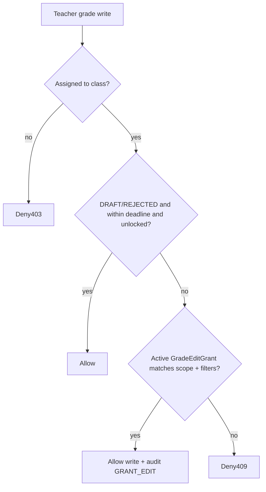

# Grade Edit Access Grants — Plan

> **Status:** Done (2026-07-31) — grants + Incomplete marker + grade-access UI + report-card “I”  
> **Goal:** Let School Admin / Principal / VPI **grant a teacher time-boxed permission** to update grades after normal edit windows close — especially **Continuous Assessment (CA)** and **Incomplete** marks  
> **Owning services:** Academic (grants + write guards), frontend-spa (grant UI + gradebook awareness); Identity only if a capability key is added for nav  
> **Companion:** `docs/GRADE_REVIEW_PLAN.md`, `docs/TEACHER_GRADEBOOK_PLAN.md`, `docs/ACADEMIC_GRADING_PLAN.md`, `IMPLEMENTATION_STATUS.md`

### Locked decisions (user 2026-07-31)

| Decision | Choice |
| :--- | :--- |
| Max grant duration | Default **14 days**; hard cap **30 days** |
| After grant-backed edit | Reset to **DRAFT**, unlock, clear lock → teacher **resubmits** → normal review |
| CA matching | `componentType === "CA"` **or** shortCode / type aliases (`CA`, `C.A.`, `CONTINUOUS`, etc.) |
| Incomplete on report cards | **Yes** — show Incomplete / “I” in report-card assembly |
| UI home | Standalone **`/{slug}/grade-access`** |

---

## 0. Problem

Today a teacher can edit grades only while entries are `DRAFT` / `REJECTED`, the cell is unlocked, and any `gradeSubmissionDeadline` has not passed. After submit/approve/lock or deadline, they are blocked. Admins can still edit/reopen, but that does not scale for routine CA corrections or Incomplete cleanup.

Schools need an **explicit grant** so a named teacher can fix those cases without making all teachers permanently able to rewrite locked grades.

---

## 1. Product rules (locked for this plan)

| Rule | Choice |
| :--- | :--- |
| Who may **create / revoke** grants | **`SCHOOL_ADMIN`, `PRINCIPAL`, `VPI` only** (not Teacher, VPA, Registrar) |
| Who may **receive** a grant | Active users with role **`TEACHER`** (same school); must still be class `TEACHER` / `CO_TEACHER` for the scoped class |
| Default without grant | Unchanged — current DRAFT/REJECTED + deadline rules |
| Grant shape | **Per teacher**, **time-boxed**, **scoped**, **audited** (not a school-wide role capability flip) |
| Primary scopes | **`CA`** and **`INCOMPLETE`** (plus optional narrow filters: class / subject / period / component) |
| Out of scope (v1) | Permanent “always edit locked grades”; parent/student edit; Super Admin grants; auto-grant on reject |

---

## 2. Concepts

### 2.1 Continuous Assessment (already exists)

CA is modeled as calendar **`ExamComponent.componentType === "CA"`** (and related Liberian/custom CA-like types if configured). Period gradebook already writes via component-grades APIs.

**Grant scope `CA`:** teacher may create/update component grades for components classified as CA under the grant’s filters, even when:

- submission deadline has passed, and/or  
- entry is `SUBMITTED` / `ACCEPTED` / `isLocked` (grant acts as a controlled reopen-for-edit)

### 2.2 Incomplete (new in Academic)

**Incomplete is not modeled today** (empty `score` in DRAFT ≠ Incomplete).

**v1 proposal:** add optional marker on `GradeEntry`:

- `incompleteReason` `String?` and/or status value **`INCOMPLETE`** in the entry status set  

**Recommended:** keep status machine for review (`DRAFT` → `SUBMITTED` → …) and add:

```text
isIncomplete Boolean @default(false)
incompleteNote String?
```

So a row can be Incomplete while still following review, **or** Incomplete after accept when an admin/teacher-with-grant marks it for later fill-in.

**Grant scope `INCOMPLETE`:** teacher may edit entries where `isIncomplete === true` (and optionally create Incomplete markers) inside the grant filters, bypassing deadline/lock the same way as CA grants.

**UI:** Incomplete badge/toggle on gradebook cells; reports/report cards can show “I” / Incomplete later (report-card wiring can be a follow-on phase).

---

## 3. Data model (Academic)

```prisma
model GradeEditGrant {
  id                String    @id @default(uuid())
  schoolId          String
  teacherId         String
  /// CA | INCOMPLETE | CA_AND_INCOMPLETE
  scope             String
  classId           String?   // null = all classes teacher is assigned to
  subjectId         String?
  academicPeriodId  String?
  examComponentId   String?   // optional single CA column
  reason            String
  startsAt          DateTime  @default(now())
  expiresAt         DateTime
  grantedById       String
  revokedAt         DateTime?
  revokedById       String?
  createdAt         DateTime  @default(now())
  updatedAt         DateTime  @updatedAt

  @@index([schoolId, teacherId, expiresAt])
  @@index([schoolId, revokedAt])
  @@schema("academic")
}
```

Plus on `GradeEntry`:

- `isIncomplete Boolean @default(false)`
- `incompleteNote String?`

**Active grant** = `revokedAt` null AND `now` in `[startsAt, expiresAt]`.

---

## 4. Authorization flow



**Grant match rules:**

1. `teacherId` = actor  
2. Grant `scope` covers the write (`CA` / `INCOMPLETE` / both)  
3. Optional filters: if `classId`/`subjectId`/`academicPeriodId`/`examComponentId` set on grant, write must match  
4. For `CA`: component type must be CA (or allow-list of CA-like types configured in one helper)  
5. For `INCOMPLETE`: target entry `isIncomplete` true (or request is setting Incomplete)

**Admins** (`SCHOOL_ADMIN` / `PRINCIPAL` / `VPI`) continue to bypass as today; they do not need grants.

**Audit:** every grant-backed write logs `GradeHistory` / system detail with `viaGrantId`. Grant create/revoke write Academic audit or Identity `systemLog` via existing pattern.

---

## 5. APIs (Academic)

| Method | Path | Who | Purpose |
| :--- | :--- | :--- | :--- |
| GET | `/api/schools/:schoolId/grade-edit-grants` | Admin trio | List (filter active/expired/teacher) |
| POST | `/api/schools/:schoolId/grade-edit-grants` | Admin trio | Create grant |
| POST | `/api/schools/:schoolId/grade-edit-grants/:id/revoke` | Admin trio | Revoke early |
| GET | `/api/schools/:schoolId/grade-edit-grants/mine` | Teacher | Active grants for current user (gradebook banner) |

Body (create): `{ teacherId, scope, reason, expiresAt, classId?, subjectId?, academicPeriodId?, examComponentId?, startsAt? }`

Wire into existing upsert paths in `examService` / component-grades:

- Before `DEADLINE_PASSED` / lock / non-DRAFT rejection, call `resolveActiveGradeEditGrant(...)`.  
- If match → allow transition back to editable (`DRAFT`, clear `isLocked` as needed) under grant policy.

**Gateway:** map new paths under academic school suffixes (same as other `/api/schools/:id/...` academic routes).

---

## 6. UI

### 6.1 Grant console (admins only)

New page or Grade Review tab: **`/{slug}/grade-access`** (or tab on Grade Review).

- List active grants; create modal (teacher picker, scope CA / Incomplete / both, optional class/subject/period, expiry, reason)  
- Revoke action  
- Nav: School Admin, Principal, VPI only (`navByRole` + `ProtectedRoute`)

### 6.2 Gradebook (teachers)

- Banner when an active grant exists: “You may edit CA / Incomplete grades until {expiry}”  
- Cells editable when grant applies even if locked/submitted  
- Incomplete toggle (with grant or admin role)

### 6.3 Notifications (optional v1.1)

In-app bell: `GRADE_EDIT_GRANTED` / `GRADE_EDIT_REVOKED` via Comms (same pattern as grade return/approve).

---

## 7. Capability / roles

- Prefer **route `requireRoles(['SCHOOL_ADMIN','PRINCIPAL','VPI'])`** for grant CRUD (matches grade review decide).  
- Optional capability: `action.grade_edit_grant.manage` defaulted to those three roles for Roles & Access consistency — **not required for v1** if role gate is enough.  
- Do **not** use school-wide `SchoolRoleCapabilityOverride` as the grant mechanism (that would unlock all teachers).

---

## 8. Phases

| Phase | Outcome |
| :--- | :--- |
| **A — Plan + Incomplete marker** | This doc; schema `isIncomplete` + history; admin/teacher can mark Incomplete on editable rows |
| **B — Grant CRUD + write guards** | `GradeEditGrant` model; APIs; upsert/deadline/lock honor active grants for CA / Incomplete |
| **C — Admin UI + teacher banner** | Grant console; gradebook editability + Incomplete UX |
| **D — Hardening** | Tests, inventories, notifications optional, report-card “I” display if needed |

---

## 9. Key files (implementation map)

| Area | Files |
| :--- | :--- |
| Schema | `services/academic/prisma/schema.prisma` |
| Access | `services/academic/src/lib/gradeAccess.ts` (extend) |
| Service | `services/academic/src/services/examService.ts` (+ small `gradeEditGrantService.ts`) |
| Routes | `services/academic/src/routes/examRoutes.ts` / new grant routes |
| Gateway | `services/gateway/src/server.ts` suffix map if needed |
| SPA | `src/features/grade-edit-grants/` (new), gradebook sheets, `navByRole.ts`, `App.tsx` |
| Tests | `tests/` grant match + upsert bypass unit tests |
| Docs | this plan; link from `IMPLEMENTATION_STATUS.md` + `docs/APP_FEATURES_OVERVIEW.md` |

---

## 10. Acceptance checks

- [ ] Without grant: teacher still blocked after deadline / on locked ACCEPTED (unchanged)  
- [ ] Admin creates CA grant → teacher can update CA component scores until expiry  
- [ ] Incomplete grant → teacher can fill Incomplete rows only; cannot freely edit unrelated locked finals  
- [ ] Expired / revoked grant stops writes immediately  
- [ ] Teacher cannot create grants; VPA/Registrar cannot create grants  
- [ ] Grant create/revoke and grant-backed edits are auditable  
- [ ] Class membership still required  

---

## 11. Open decisions — **resolved**

See **Locked decisions** at top. No further product blockers.

---

## Changelog

### 2026-07-31 — Confirmed; shipped

- **Change:** Locked defaults (14d/30d cap, DRAFT resubmit, CA aliases, report-card Incomplete, `/grade-access` page); Academic grants + Incomplete; SPA grant console + gradebook banner; report-card “I”
- **Status:** done
- **Verify:** `npm run test:grade-edit-grant`; create grant → teacher edits CA past lock → DRAFT; Incomplete “I” on report card

### 2026-07-31 — Plan drafted

- **Change:** Proposed time-boxed `GradeEditGrant` + Incomplete marker; grantors = School Admin / Principal / VPI  
- **Services:** academic, frontend-spa (+ gateway if routes need mapping)  
- **Status:** superseded by confirmation
