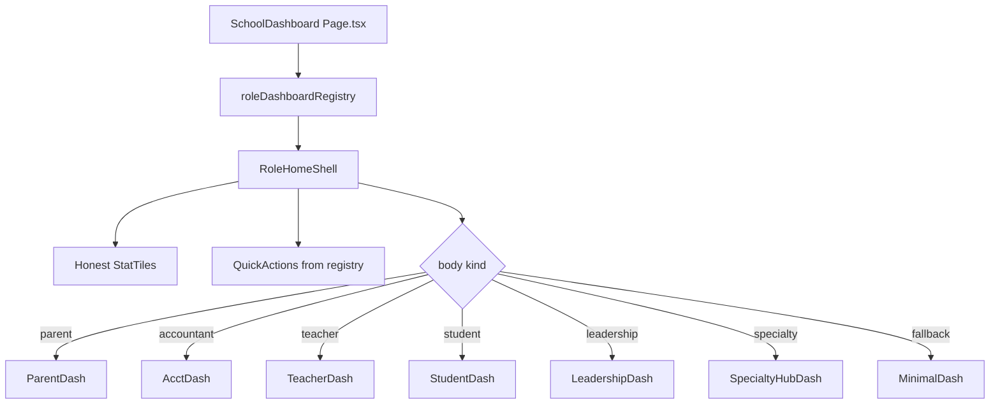

# Role-customized dashboards — Implementation Plan

> **Status:** Done (2026-08-04) — Phases 0–4 shipped: registry + honesty pass, Student/Teacher homes, leadership shells, specialty hub cards  
> **Goal:** Every school account type lands on a home dashboard that matches **their role’s daily job** — honest KPIs + shortcuts to pages they can actually use.  
> **Owning services:** Frontend (`frontend-spa`); Identity / Classroom / Academic / Finance / Ops / Lifecycle / Comms only where new **honest** aggregates are required.  
> **Non-goals:** Fake charts/telemetry; rebuilding specialty ops product hubs (library, clinic, bus routes) from scratch; Super Admin redesign (keep `pages/SuperAdmin/Dashboard.tsx`).  
> **Companions:** `ROLES_DOCUMENTATION.md`, `docs/ROLE_GUIDED_WIZARD_PLAN.md`, `docs/ROLE_ACCESS_PLAN.md`, `docs/PARENT_PORTAL_AND_PTA_PLAN.md`, `docs/FINANCE_BILLING_PLAN.md`, `FRONTEND_GUIDELINES.md`, `IMPLEMENTATION_STATUS.md`

---

## 0. Product intent

Today only **Parent** and **Accountant** have purpose-built dashboards. Everyone else shares `DefaultRoleDashboard` with invented attendance charts, static “upcoming events,” and (for many roles) **School Admin–style shortcuts** that do not match nav — worst for **Student** and specialty ops.

| Principle | Rule |
| :--- | :--- |
| **Role-first** | Home shows what *this* account needs next, not school-wide admin chrome. |
| **Honest UI** | No fabricated counts, %, or trends. Missing API → `—` or empty state. |
| **Access-aligned** | Quick actions ⊆ that role’s nav (capability-filtered). No CTAs to 403 pages. |
| **One composition** | Header + KPI row + shortcuts + 1–2 role panels. Not a second sidebar. |
| **Reuse** | Parent / Accountant patterns are the gold standard; extract shared chrome. |

---

## 1. Current state (honest)

| Role group | Today | Gap |
| :--- | :--- | :--- |
| PARENT | Dedicated `ParentDashboard` (real family APIs) | Keep; light polish only |
| ACCOUNTANT | Dedicated `AccountantDashboard` (finance summary) | Keep |
| TEACHER / REGISTRAR / VPI / VPA | Custom **stat chrome** + shared default body | Fake numbers; weak panels |
| SCHOOL_ADMIN / PRINCIPAL | Default school stats + few shortcuts | Not executive / ops home |
| STUDENT | School-wide stats + admin shortcuts | **Severe** mismatch |
| Specialty ops (11 roles) | Same admin defaults | **Severe** — ignore their hubs |
| SUPER_ADMIN | Separate platform page | Out of scope here |

**Key files today**

| Path | Role |
| :--- | :--- |
| `src/features/dashboard/Page.tsx` | Role switch, fake `getRoleStats`, quick actions |
| `src/features/dashboard/components/{Parent,Accountant,DefaultRole}Dashboard.tsx` | Bodies |
| `src/features/dashboard/hooks/useDashboardQuery.ts` | School stats + finance summary |
| `src/constants/navByRole.ts` | Source of truth for “what they can access” |
| `src/constants/roles.ts` | 21 roles |

---

## 2. Target architecture



### Shared building blocks (`src/features/dashboard/`)

| Module | Purpose |
| :--- | :--- |
| `registry.ts` | Per-role: title key, KPI defs, quick actions, body component id |
| `components/RoleHomeShell.tsx` | Consistent header / KPI grid / action row / children |
| `components/QuickActionRow.tsx` | Buttons filtered by `capabilities` + nav |
| `components/HonestStatTile.tsx` | Value `—` when null; no fake `+2%` |
| `roleStats/*.ts` | Loaders that return `null` or real numbers only |
| Keep | `ParentDashboard`, `AccountantDashboard` |

### Registry shape (sketch)

```ts
type RoleDashboardDef = {
  role: Role;
  titleKey: string;           // pages:dashboard.titles.*
  subtitleKey?: string;
  quickActions: { labelKey: string; path: string; icon: LucideIcon }[];
  kpis: KpiDef[];             // { id, labelKey, resolve: (ctx) => number | null }
  body: "parent" | "accountant" | "teacher" | "student"
      | "leadership" | "specialty" | "minimal";
};
```

Quick actions always resolve against `/${slug}/…` and skip items the session lacks capability for (same idea as Layout nav filtering).

---

## 3. Per-role target compositions

### Tier A — personal consumers (fix first)

| Role | KPIs (honest only) | Quick access | Body |
| :--- | :--- | :--- | :--- |
| **STUDENT** | Classes enrolled; fees due; unread alerts; attendance this week (or `—`) | My Classes, Grades, Online exams, Fees, My schedule | Upcoming schedule strip + announcements + fees due list |
| **TEACHER** | My classrooms count; students on my rosters; pending grade submissions; today’s attendance sessions left (or `—`) | Attendance, My Classes, Gradebook, Lesson plans, Exams | Today’s classes / “needs attention” (open grade reviews, unsubmitted papers) |
| **PARENT** | Keep current | Optional: add PTA / Documents chips | Keep |

### Tier B — school leadership & academics

| Role | KPIs | Quick access | Body |
| :--- | :--- | :--- | :--- |
| **SCHOOL_ADMIN** | Students, teachers (real); open setup checklist remaining; pending leave or apps if available else omit | Setup, Classrooms, Fees, Staff, Settings, Reports | Setup checklist widget + recent activity logs |
| **PRINCIPAL** | Students, teachers; pending grade reviews if API exists else omit | Grade review, Curriculum, Admissions, Reports, Leave | Recent activity + links to year-transition / promotion when entitled |
| **VPI** | Classrooms / teachers (real); grade-review queue size when real | Curriculum, Classrooms, Exams, Grade review, Lesson plans | Academic queue panel (reviews / papers) — empty if none |
| **VPA** | Staff count proxy (teachers) until staff total API; open work orders / leave when real | Staff, Leave, Maintenance, Procurement, Security | Ops shortcuts + recent logs |
| **REGISTRAR** | Students; applications total/pending when Identity returns real (today null → show `—`, **remove 98% enrollment**) | Admissions, Students, Transcripts, Certificates, Enrollment | Application funnel empty-state until APIs filled |
| **ACCOUNTANT** | Keep finance summary | Keep Fees / Expenses / Payroll | Keep |

### Tier C — specialty ops (hub home, no fake domain metrics)

For roles whose product hubs are thin/stubbed, ship a **SpecialtyHubDashboard**: role label + short “your workspace” copy + **large cards linking to each ops nav leaf** (bus routes, work orders, library, clinic, …) + Staff portal + Calendar. KPIs only when a real count exists; otherwise no KPI row.

| Role | Hub links (from nav) |
| :--- | :--- |
| TRANSPORTATION | Bus routes, Drivers, Vehicle maintenance |
| MAINTENANCE | Work orders, Facilities hub |
| LIBRARIAN | Library, Digital resources |
| NURSE | Clinic, Medical inventory |
| COUNSELOR | Counseling, Student wellbeing |
| SECURITY | Security / incidents (per nav) |
| IT_ADMIN | Settings, Reports, Staff portal |
| PROCUREMENT | Procurement (per nav) |
| ATHLETICS_DIRECTOR | Athletics hub |
| HOSTEL_WARDEN | Hostel hub |
| CAFETERIA_MANAGER | Cafeteria hub |

When a hub page is still a stub, the card still deep-links (honest stub page) — do **not** invent occupancy/ticket charts.

### Out of scope

| Role | Notes |
| :--- | :--- |
| SUPER_ADMIN | Keep platform dashboard; optional later polish in `SUPER_ADMIN_PLATFORM_PLAN.md` |

---

## 4. Data honesty & API work

### Immediate frontend honesty (Phase 0 — no new backends)

1. Delete hardcoded Teacher / VPI / VPA / Registrar fake values in `Page.tsx`.
2. Remove DefaultRoleDashboard invented attendance series and static fake events (or replace events with **real** calendar feed when available; else empty state).
3. Keep `recentLogs` when present.
4. Stat tile `change` labels: drop cosmetic `+0` / `+2%` unless backed by period comparison.

### Optional backend enrichments (Phase 1–2, only if UI would otherwise stay empty)

| KPI | Suggested source | Service |
| :--- | :--- | :--- |
| Teacher: my classroom count + roster size | Existing classroom membership APIs for current user | Classroom |
| Teacher: pending grade submissions | Grade-review queue filtered to submitter | Academic |
| Student: my classrooms / fees due | Classroom membership + `/api/my-fees` | Classroom + Finance |
| Student/Teacher: unread alerts | `notificationsApi.list` | Comms |
| Registrar: applications counts | Wire Identity stats fields that are currently `null` | Identity |
| Admin: setup checklist remaining | Reuse `setupChecklist.ts` | Frontend + existing APIs |
| Maintenance: open work orders | Ops list count if endpoint exists | Ops |

**Rule:** Prefer soft-fail `Promise.allSettled`. Never invent a number to fill a tile — omit the tile instead.

---

## 5. Phases

### Phase 0 — Foundation + honesty ✅

- [x] Add `registry.ts`, `RoleHomeShell`, `QuickActionRow`, honest activity panel
- [x] Refactor `Page.tsx` to render from registry; keep Parent / Accountant bodies
- [x] Strip all fake KPIs/charts/events from default path
- [x] Capability-filter quick actions
- [x] Unit tests: registry covers every `SCHOOL_ROLES` entry (`tests/role-dashboards.test.ts`)

### Phase 1 — Student + Teacher (severe mismatch) ✅

- [x] `StudentDashboard.tsx` + real loaders (classes, fees, notifications)
- [x] `TeacherDashboard.tsx` + real loaders (rooms, roster seats)
- [x] i18n keys under `pages.dashboard.*` for new copy
- [x] Student/Teacher CTAs match role nav (no admin Curriculum/Reports/Settings)

### Phase 2 — Leadership (Admin, Principal, VPI, VPA, Registrar) ✅

- [x] `LeadershipDashboard.tsx` via registry `leadershipKpis` presets
- [x] School Admin: setup checklist remaining + todo links
- [x] Registrar: applications tiles show `—` when Identity stats null (no fake enrollment %)
- [x] Shortcuts aligned with each role’s nav

### Phase 3 — Specialty hub homes ✅

- [x] `SpecialtyHubDashboard.tsx` driven by registry hub links
- [x] One visual pattern for all specialty roles (+ IT Admin)
- [x] No fake domain KPIs

### Phase 4 — Polish, docs, rebuild ✅

- [x] Empty states / loading copy
- [x] Guide banner retained on shell
- [x] `IMPLEMENTATION_STATUS.md` + this plan updated
- [x] `npm run test:role-dashboards` → rebuild `frontend-spa`

---

## 6. Acceptance checks

| # | Check |
| :--- | :--- |
| 1 | Every school role has an explicit registry entry (no silent Default with admin CTAs). |
| 2 | Student home CTAs ⊆ student nav; Teacher ⊆ teacher nav. |
| 3 | No hardcoded attendance %, enrollment %, class counts on any role home. |
| 4 | Parent + Accountant behavior unchanged (regression). |
| 5 | Specialty roles see hub cards for their ops routes, not Curriculum/Reports/Settings. |
| 6 | Missing data → `—` or empty copy, never filler charts. |
| 7 | Quick actions respect capability overrides from Roles & Access. |
| 8 | Mobile: KPI grid stacks; action row wraps (`FRONTEND_GUIDELINES` / responsive). |

---

## 7. Doc updates (same task when shipping)

| Doc | Update |
| :--- | :--- |
| This plan | Status banners per phase |
| `IMPLEMENTATION_STATUS.md` | Honest gaps entry linking here |
| `ROLES_DOCUMENTATION.md` | Replace aspirational dashboard claims with shipped surfaces |
| `docs/ROLE_GUIDED_WIZARD_PLAN.md` | Note dashboard banner still uses guide track; no HelpGuidePanel |

---

## 8. Open questions (confirm before / during Phase 1)

1. **Specialty hubs:** Confirm hub-card pattern is enough until library/clinic/bus products deepen — yes/no?
2. **Student fees on home:** Show amount due or only count of open invoices?
3. **Teacher “pending grades”:** OK to hide the tile until grade-review API supports teacher-scoped count?
4. **Principal vs School Admin:** Same shell with different action sets, or fully separate layouts?

**Recommended defaults if you just say “go”:** (1) yes hub cards, (2) count + total due when finance returns it, (3) hide until real, (4) same shell, different registry entries.

---

## 9. Effort sketch

| Phase | Effort | Touches |
| :--- | :--- | :--- |
| 0 | S–M | Frontend structure + honesty |
| 1 | M | Student/Teacher + light API reuse |
| 2 | M | Leadership compositions + checklist |
| 3 | S | Specialty registry + one component |
| 4 | S | Docs, i18n, tests, rebuild |

---

## Plan progress

- [x] 1. Draft plan (this doc)
- [x] 2. User confirmation
- [x] 3. Implement phases
- [x] 4. Update status + companions
- [x] 5. Tests + rebuild touched services

### Changelog

| Date | Change |
| :--- | :--- |
| 2026-08-04 | Shipped role registry + RoleHomeShell; Student/Teacher/Leadership/Specialty bodies; removed fake attendance chart/events and hardcoded Teacher/VPI/VPA/Registrar KPIs; capability-filtered quick actions; `test:role-dashboards` |
